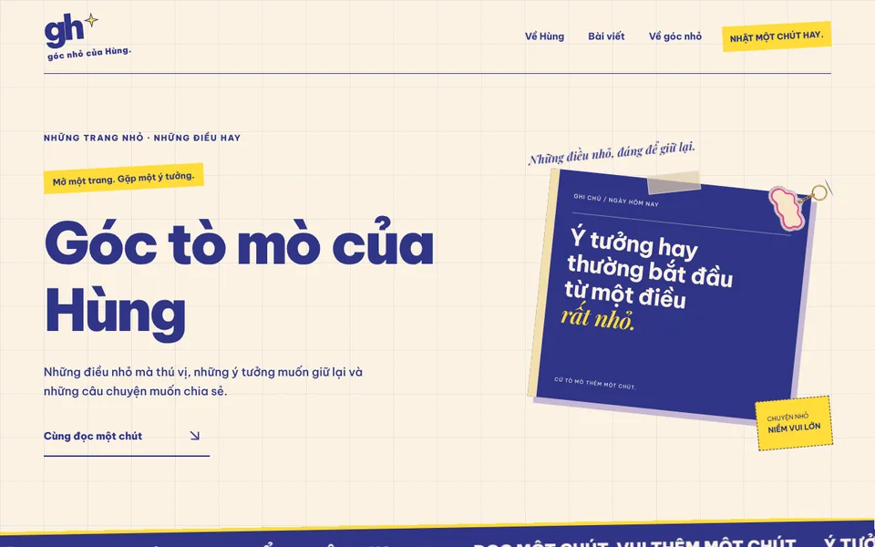
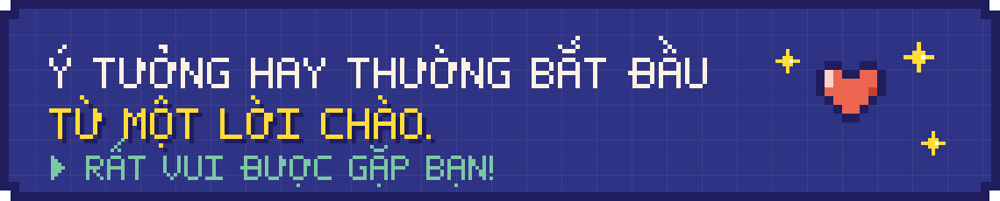

  <a href="https://hunghienhoa.com"><b>Portfolio ↗</b></a> &nbsp;·&nbsp;
  <a href="https://photobooth.hunghienhoa.com">Hộp Ảnh</a> &nbsp;·&nbsp;
  <a href="https://blog.hunghienhoa.com">Góc tò mò</a> &nbsp;·&nbsp;
  <a href="https://snap.hunghienhoa.com">Snap</a> &nbsp;·&nbsp;
  <a href="https://lamnet.hunghienhoa.com">Làm Nét</a>

Mình là **Hùng** — Hùng Hiền Hòa. Mình thích những ý tưởng có cá tính, những thiết kế có chuyện để kể và những điều nhỏ khiến một ngày thú vị hơn. Đây là chiếc hộp mình gom những thứ đang làm.

## Có gì trong chiếc hộp?

<table>
  <tr>
    <td width="50%" valign="top">
      
      <h3>Hộp Ảnh</h3>
      
Photobooth trực tuyến: bốn khoảnh khắc, một dải kỷ niệm.

      <a href="https://photobooth.hunghienhoa.com"><b>photobooth.hunghienhoa.com ↗</b></a>
    </td>
    <td width="50%" valign="top">
      
      <h3>Góc tò mò</h3>
      
Những điều nhỏ mà thú vị và những câu chuyện muốn chia sẻ.

      <a href="https://blog.hunghienhoa.com"><b>blog.hunghienhoa.com ↗</b></a>
    </td>
  </tr>
  <tr>
    <td width="50%" valign="top">
      
      <h3>Snap</h3>
      
Video hay từ TikTok, Instagram và Facebook, để dành xem lại.

      <a href="https://snap.hunghienhoa.com"><b>snap.hunghienhoa.com ↗</b></a>
    </td>
    <td width="50%" valign="top">
      
      <h3>Làm Nét</h3>
      
Ảnh hơi mờ? AI phóng to 4 lần, ngay trong trình duyệt.

      <a href="https://lamnet.hunghienhoa.com"><b>lamnet.hunghienhoa.com ↗</b></a>
    </td>
  </tr>
</table>

## Bên trong xưởng nhỏ

  
  
  
  
  
  
  
  

Ảnh ở Hộp Ảnh và Làm Nét chỉ nằm trong trình duyệt của bạn, không gửi lên máy chủ.

## Bắt đầu bằng một lời chào

Có ý tưởng muốn trao đổi, muốn góp một chiếc khung ảnh hay chỉ muốn chào nhau một tiếng?

**[Gửi email cho mình ↗](mailto:hunghienhoa2110@gmail.com)** &nbsp; `hunghienhoa2110@gmail.com`

  &nbsp;&nbsp;
  &nbsp;&nbsp;
  &nbsp;&nbsp;
  &nbsp;&nbsp;
  &nbsp;&nbsp;
  
  &nbsp;&nbsp;WeChat: <code>bqhtit</code>

  
<b>Bạn đến đây vì mã nguồn?</b>

 

- [Mã nguồn, chạy trên máy và công cụ kiểm tra](PROJECT.md)
- [Triển khai, giám sát và sao lưu](DEPLOYMENT.md)
- [API và quyền riêng tư](API-CONTRACT.md)
- [Quy trình ứng phó sự cố](INCIDENT-RESPONSE.md)

