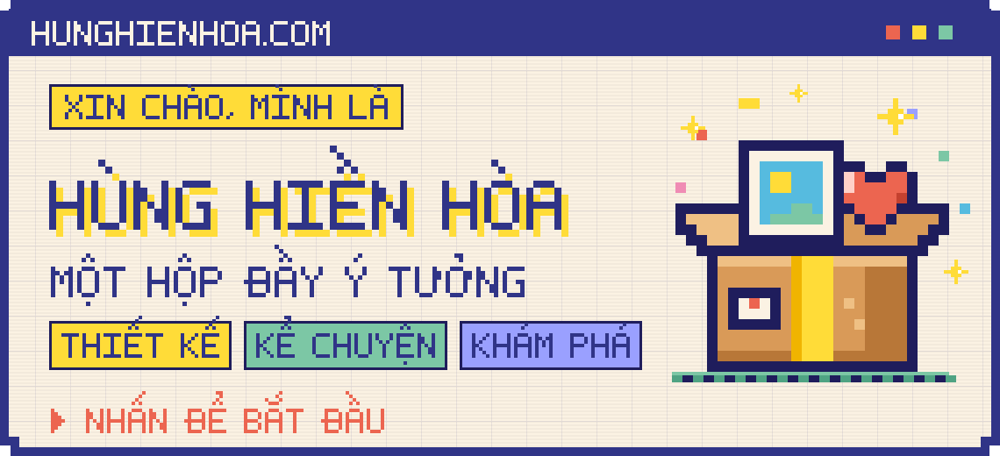
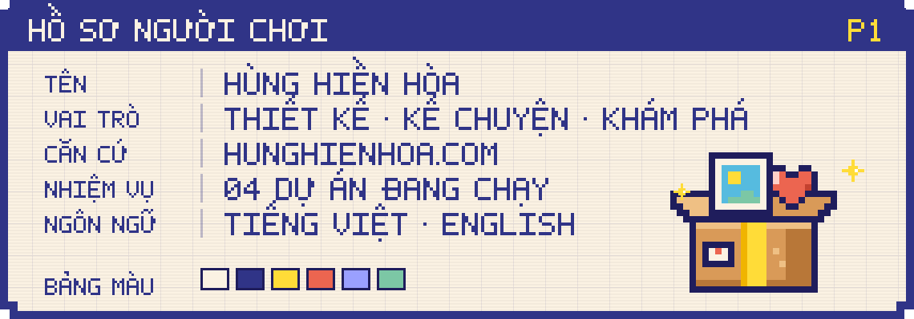
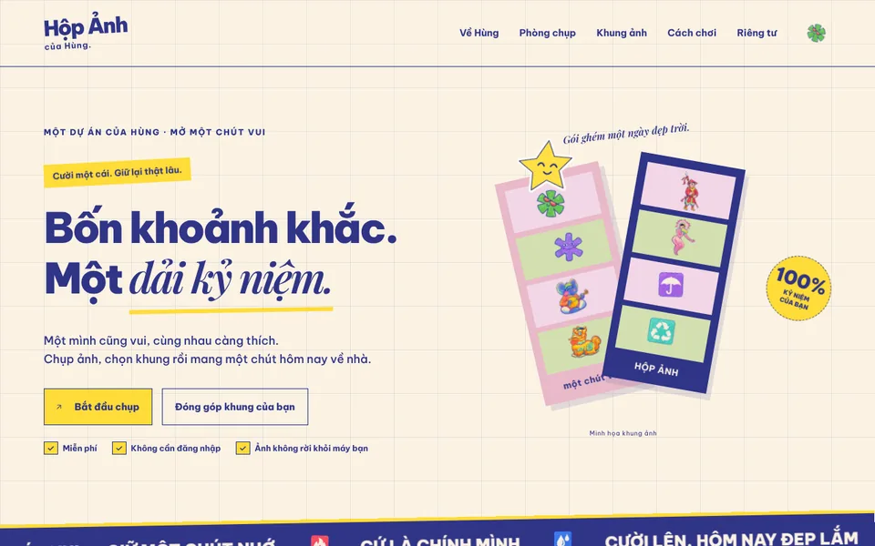
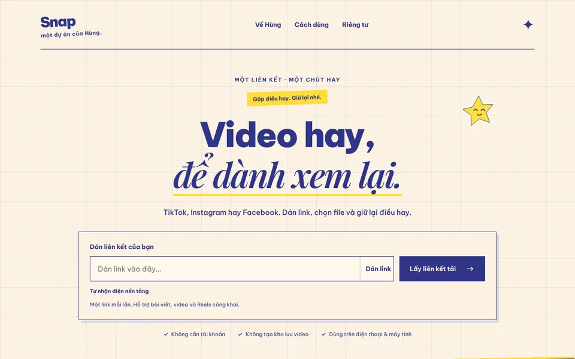
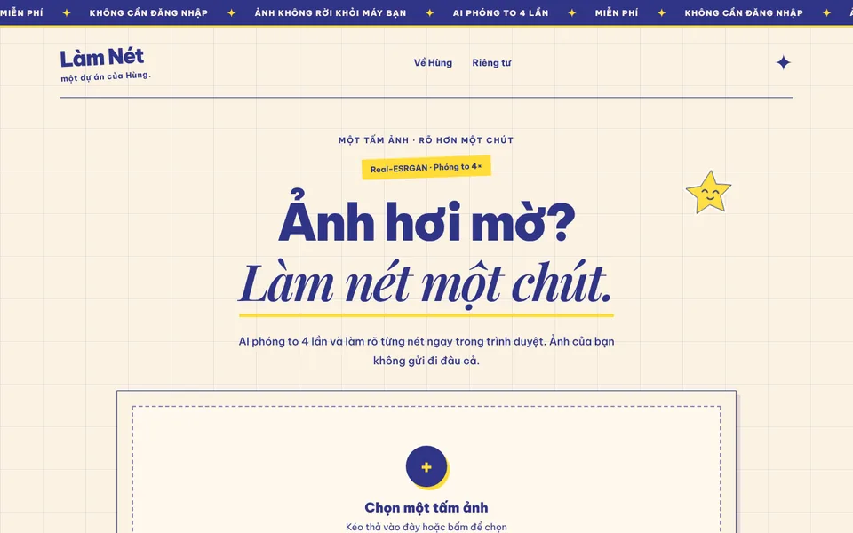
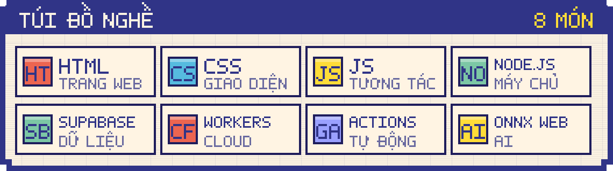

  

  <a href="https://hunghienhoa.com"><b>PORTFOLIO ↗</b></a> &nbsp;▸&nbsp;
  <a href="https://hunghienhoa.com/photobooth/">Hộp Ảnh</a> &nbsp;▸&nbsp;
  <a href="https://hunghienhoa.com/blog/">Góc tò mò</a> &nbsp;▸&nbsp;
  <a href="https://hunghienhoa.com/snaptik/">Snap</a> &nbsp;▸&nbsp;
  <a href="https://hunghienhoa.com/lamnet/">Làm Nét</a>

  

Mình là **Hùng** — Hùng Hiền Hòa. Mình thích những ý tưởng có cá tính, những thiết kế có chuyện để kể và những điều nhỏ khiến một ngày thú vị hơn. Đây là chiếc hộp mình gom những thứ đang làm: mỗi ngăn là một sản phẩm chạy thật, thiết kế tay và viết mã từ đầu.

<h2 align="center"></h2>

<table>
  <tr>
    <td width="50%" valign="top">
      
      
      
Photobooth trực tuyến: bốn khoảnh khắc, một dải kỷ niệm.

      <a href="https://hunghienhoa.com/photobooth/"><b>▶ hunghienhoa.com/photobooth</b></a>
    </td>
    <td width="50%" valign="top">
      
      
      
Những điều nhỏ mà thú vị và những câu chuyện muốn chia sẻ.

      <a href="https://hunghienhoa.com/blog/"><b>▶ hunghienhoa.com/blog</b></a>
    </td>
  </tr>
  <tr>
    <td width="50%" valign="top">
      
      
      
Video hay từ TikTok, Instagram và Facebook, để dành xem lại.

      <a href="https://hunghienhoa.com/snaptik/"><b>▶ hunghienhoa.com/snaptik</b></a>
    </td>
    <td width="50%" valign="top">
      
      
      
Ảnh hơi mờ? AI phóng to 4 lần, ngay trong trình duyệt.

      <a href="https://hunghienhoa.com/lamnet/"><b>▶ hunghienhoa.com/lamnet</b></a>
    </td>
  </tr>
</table>

> **Quyền riêng tư:** ảnh ở Hộp Ảnh chỉ nằm trong trình duyệt của bạn. Làm Nét mặc định chạy AI ngay trên máy; chỉ khi bạn tự chọn chế độ đám mây và đồng ý thì ảnh mới được gửi đi xử lý, và máy chủ không lưu lại.

<h2 align="center"></h2>

  

<h2 align="center"></h2>

Có ý tưởng muốn trao đổi, muốn góp một chiếc khung ảnh hay chỉ muốn chào nhau một tiếng?

  
  &nbsp; <code>hunghienhoa2110@gmail.com</code>

  &nbsp;&nbsp;
  &nbsp;&nbsp;
  &nbsp;&nbsp;
  &nbsp;&nbsp;
  &nbsp;&nbsp;
  
  &nbsp;&nbsp;WeChat: <code>bqhtit</code>

  
<b>▸ Bạn đến đây vì mã nguồn?</b>

 

- [Mã nguồn, chạy trên máy và công cụ kiểm tra](PROJECT.md)
- [Triển khai, giám sát và sao lưu](DEPLOYMENT.md)
- [API và quyền riêng tư](API-CONTRACT.md)
- [Bảo mật](SECURITY.md)
- [Quy trình ứng phó sự cố](INCIDENT-RESPONSE.md)

Ảnh pixel trong trang này sinh bằng `python tools/build-readme-art.py` (thư mục `.github/profile`).

